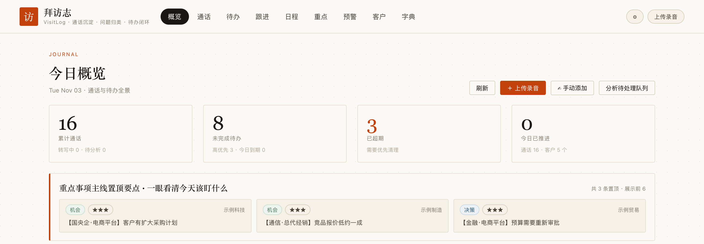
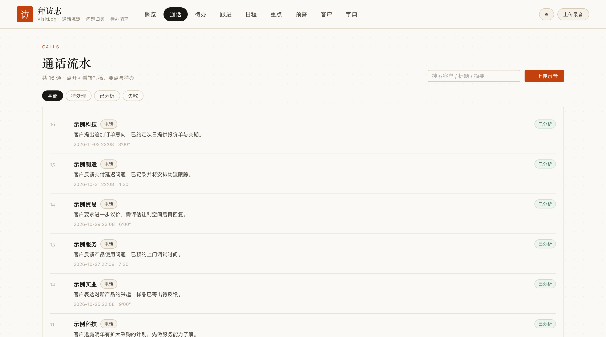
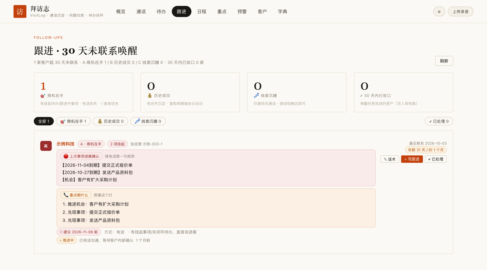
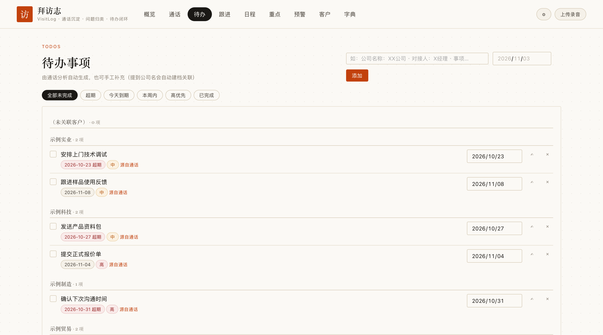
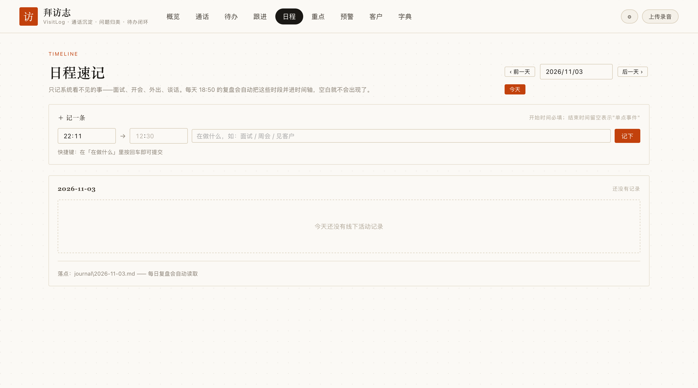
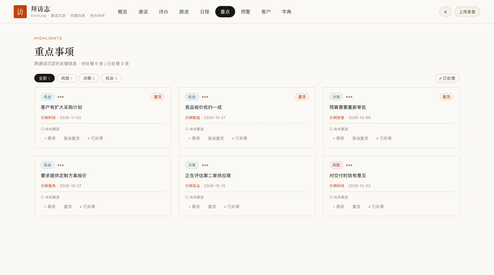
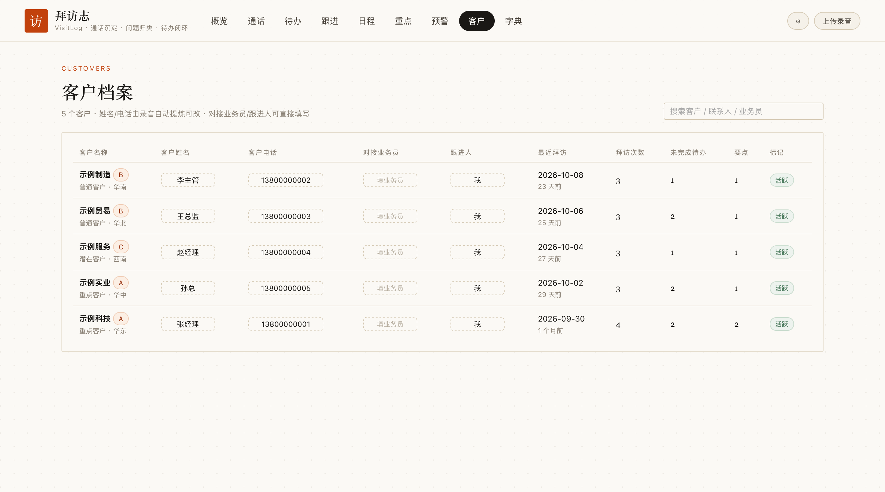

# 拜访志 VisitLog

> 客户通话记录平台：**上传录音 → 自动转写 → AI 拆解归类 → 待办与重点沉淀 → 跟进闭环**。
> 单机可跑，唯一外部依赖是 `multer`，数据全部留在自己的磁盘上。

纯本地运行，零云端依赖，零外部 npm 依赖（除可选的 multer 加速上传解析）。数据全部留在你自己的机器上。



<table>
<tr>
<td width="50%"></td>
<td width="50%"></td>
</tr>
<tr>
<td align="center"><b>通话流水</b> — 每通电话的摘要、时长、分析状态</td>
<td align="center"><b>跟进唤醒台</b> — 按沉默天数分层，配可编辑话术点</td>
</tr>
<tr>
<td width="50%"></td>
<td width="50%"></td>
</tr>
<tr>
<td align="center"><b>待办事项</b> — 按客户分组、超期高亮、到期日自动避让休假日</td>
<td align="center"><b>日程速记</b> — 线下活动补录，按天落成 Markdown</td>
</tr>
<tr>
<td width="50%"></td>
<td width="50%"></td>
</tr>
<tr>
<td align="center"><b>重点事项</b> — 强制【客户类型】前缀，一眼分辨客户属性</td>
<td align="center"><b>客户档案</b> — 联系人、跟进人、沉默天数、拜访次数</td>
</tr>
</table>

> 📖 **第一次来？** 看 [下载与安装手册](INSTALL.md) → [操作手册](OPERATION.md)。
> 遇到问题查 [故障排查](TROUBLESHOOTING.md)。

---

## 三条命令跑起来

```bash
git clone https://github.com/billhao2026/VisitLog.git
cd visitlog
docker compose up -d
```

打开 **http://localhost:8897/**。

不想用 Docker？`npm start` 即可（核心功能零依赖，不需要 `npm install`）。

**想先看看长什么样？**

```bash
npm run demo
```

灌入一批虚构的演示数据（16 通通话 / 5 个客户 / 8 条待办），打开界面立刻能看到完整效果。

---

## 特性

- **本地转写**：基于 faster-whisper（small / int8 CPU），录音不出本机
- **AI 结构化拆解**：一键复制分析指令给任意 AI 对话，输出 JSON 自动回写（摘要 / 评分 / 情绪 / 分类 / 要点 / 待办）
- **改判反哺**：人工改分类后自动提议归类规则，采纳后下次自动命中
- **37 条销售场景分类字典**：需求 / 报价 / 账期 / 售后 / 竞品流失 / 客情…
- **术语纠错**：转写后按字典自动替换（如把误识别的词纠正为正确写法），新增术语立即对历史稿件生效
- **客户档案**：联系人、电话、拜访历史、跟进时间线，离线 HTML 快照可发给客户
- **待办与重点事项**：超期 / 今天 / 本周分组，支持共享页外部反馈回填
- **数据自持**：SQLite 单文件，写操作前自动备份；可一键导出
- **工作日推算**：待办到期日自动避让周末与手动标记的休假日；改休假日会重排所有未完成待办
- **日程**：独立的日程记录页，与待办、重点事项分工（待办=要做的事，日程=什么时候做）
- **跟进唤醒台**：按沉默天数分层的待唤醒客户，配可编辑话术
- **重点事项强制【客户类型】前缀**：每条要点以 `【类型】` 开头 —— 行业维度 8+1（党政 / 国央企 / 能源 / 金融 / 通信 / 交通 / 医疗 / 教育 / 军队）+ 渠道性质 5 类（电商平台 / 总代经销 / 集成商 / 服务商 / 终端用户）。判定铁律：**以终端客户的行业为准**，判不出来不臆造
- **版本迭代时间表**：设置页内置 6 代版本谱系（`CHANGELOG.json` + `GET /api/version`），打包发布留痕（`RELEASES.json` + `GET /api/releases`）
- **跨行业可复用**：分类字典与术语表可自行改造，见[跨行业复用](#跨行业复用)

---

## 环境要求

| 依赖 | 版本 | 说明 |
|---|---|---|
| Node.js | **≥ 22.5** | 需要内置的 `node:sqlite`，22.5 以下不支持 |
| Python | ≥ 3.9 | **仅转写功能需要**，不装也能用系统其余部分 |
| 磁盘 | ~1.5GB | 转写模型约 500MB + 数据 |

---

---

## 功能全景

1. **上传录音** — 右上角「上传录音」，支持拖拽 / 手机选择，重复录音自动识别跳过
2. **等转写** — 上传后自动排队转写（约 2-5 分钟 / 10 分钟音频），队列徽标实时显示
3. **分析** — 转写完成后打开通话详情 → 点「复制分析指令」→ 粘贴给任意 AI 对话 → AI 输出 JSON 自动回写
4. **改判反哺** — 详情页点分类标签可直接改判，系统会提议「自动归类规则」
5. **查看** — 概览（通话量趋势 / 归类分布 / 待跟进客户）、通话流水、待办、重点事项、客户档案、字典

---

## 启用转写（可选）

不装也能用——只是无法自动转写，你可以手动粘贴文本。

```bash
python3 -m venv .venv
source .venv/bin/activate        # Windows: .venv\Scripts\activate
pip install -r requirements.txt
npm run download-model            # 下载 small 模型，约 500MB
```

Docker 方式已经内置 Python 与模型，无需额外操作。

---

## 手机录音上传（可选）

手机与电脑连同一 WiFi，访问 `http://<电脑局域网IP>:8897/`。

> **建议先设置访问口令**：进入「设置」页设置口令后，同一 WiFi 的其他人需要口令才能访问你的全部数据与接口。本机 localhost 不受影响。

---

### 下载模型

1. **模型** — small（int8 CPU），比 base 明显更准，约 3-6 分钟 / 10 分钟音频
2. **热词注入** — 转写时注入通用销售场景词表；**你自己行业的品牌名和专有词，在「字典」页添加后会自动注入转写**，无需改代码
3. **术语纠错** — 转写后按字典自动替换误识别词，新增后历史稿件自动重套

> 这三层机制里，模型是通用的，**热词和术语是行业专属的**——这正是本系统可迁移的部分：把你的行业词表喂进字典页，准确度立刻追上来。

---

## 目录结构

```
server/        Node 原生 HTTP 服务（零框架）+ SQLite（WAL，写前自动备份）
server/auth.js     局域网访问口令与会话
server/workdays.js 工作日推算 + 休假日标记 + 待办自动重排
server/api_journal.js       日程接口
server/api_followups_board.js 跟进唤醒台接口
public/        前端（暖调纸感 Editorial 风格，ECharts 本地内联）
public/page-journal.js      日程页
public/page-followups.js    跟进唤醒台页
scripts/       转写脚本（faster-whisper，本地模型）
scripts/weekly_report/  周报生成与邮件发送（可选）
prompts/       分析提示词模板
data/          calls.db + 备份 + 转写中间文件（.gitignore 排除）
audio/raw/     录音原文件，sha1 去重（.gitignore 排除）
models/        Whisper 模型文件（.gitignore 排除）
```

---

## 配置

所有配置均为可选，复制 `.env.example` 为 `.env` 后按需修改：

| 变量 | 默认 | 说明 |
|---|---|---|
| `PORT` | `8897` | 服务端口 |
| `VL_OWNER` | 空 | 跟进人 / 记录人默认值，也可在「设置」页改 |
| `VL_PY` | 自动查找 | Python 解释器路径 |
| `VL_MODEL_DIR` | `models/small` | Whisper 模型目录 |
| `VL_SMTP_HOST` | — | SMTP 服务器，配了才能发周报邮件 |
| `VL_SMTP_USER` / `VL_SMTP_PASS` | — | 发件邮箱与**授权码** |
| `VL_SMTP_TO` | 同发件人 | 收件人 |

启动时加载：`.env` → `npm run start:env`

---

## 周报（可选）

```bash
npm run weekly
```

生成上周 HTML 报告到 `报告/` 目录；配置了 SMTP 环境变量时会一并发送到邮箱，未配置则只生成文件。

---

## 数据与安全

- 数据库 `data/calls.db`，每次写操作前自动备份（保留 20 份），崩溃后卡住的任务自动重跑
- **所有数据仅存本机，无任何外发**：转写本地完成，AI 分析是你手动复制粘贴给外部 AI 的，系统本身不联网
- 录音、数据库、转写中间文件均已在 `.gitignore` 中排除，不会误入版本库
- 局域网访问默认无口令，**建议在「设置」页设置口令**

---

## 已知限制

- 需 Node ≥ 22.5（`node:sqlite` 尚为实验特性，启动时的 `ExperimentalWarning` 属正常现象）
- 转写为串行队列，不并发抢 CPU；长音频请预留时间
- 「分享链接」是带 token 的静态页，无口令校验，生成后请勿公开外传

---

## 文档

| 文档 | 内容 |
|---|---|
| [INSTALL.md](INSTALL.md) | **下载与安装手册** —— 环境要求、克隆、Docker / 本地两种安装、配置、迁移 |
| [OPERATION.md](OPERATION.md) | **操作手册** —— 日常流程、术语纠错、跨行业复用指南 |
| [TROUBLESHOOTING.md](TROUBLESHOOTING.md) | 故障排查 —— 按现象查原因和修法 |
| [CONTRIBUTING.md](CONTRIBUTING.md) | 贡献指南 —— 开发环境、代码规范、测试、PR 流程 |
| [CODE_OF_CONDUCT.md](CODE_OF_CONDUCT.md) | 行为准则 |
| [SECURITY.md](SECURITY.md) | 安全策略 —— 漏洞报告方式、已知限制、自我保护建议 |
| [SUPPORT.md](SUPPORT.md) | 获取支持 —— 提问格式与脱敏提醒 |
| [CHANGELOG.md](CHANGELOG.md) | 更新日志 |
| 在线手册 | 启动后访问 `http://localhost:8897/manual.html` |

---

## 开发

```bash
npm test        # 29 个冒烟测试，零新增依赖
npm run demo    # 灌入虚构演示数据
```

测试跑在临时目录的隔离沙箱里，**不会碰你的真实数据**。

---

## 跨行业复用

这套系统的**框架是通用的**，**分类字典和术语才是行业专属的**。复用到你的行业，三步：

1. **改分类字典** —— 「字典」页增删改。内置的 37 个二级分类（需求 / 报价 / 合同 / 账期 / 售后 / 竞品 / 流失 / 客情 / 内部协同）几乎覆盖所有 B2B 销售场景
2. **喂行业术语** —— 把品牌名、型号、专业黑话加进术语表。系统会自动纠正转写错误，**并把正确写法加入热词提升后续识别率**
3. **改提示词** —— 编辑 `prompts/analysis.md`，调整输出字段和分类要求

详见 [操作手册 · 跨行业复用指南](OPERATION.md#八跨行业复用指南)。

---

## 致谢

- [faster-whisper](https://github.com/SYSTRAN/faster-whisper) — 本地语音转写
- [Apache ECharts](https://echarts.apache.org/) — 前端图表（Apache-2.0）

---

## 参与贡献

欢迎提 Issue、提 PR。详见 [CONTRIBUTING.md](CONTRIBUTING.md) 与 [行为准则](CODE_OF_CONDUCT.md)。

```bash
git clone https://github.com/billhao2026/VisitLog.git
cd visitlog
npm test        # 29 个冒烟测试，零新增依赖
```

---

## 许可证

[MIT](LICENSE) © VisitLog Contributors
